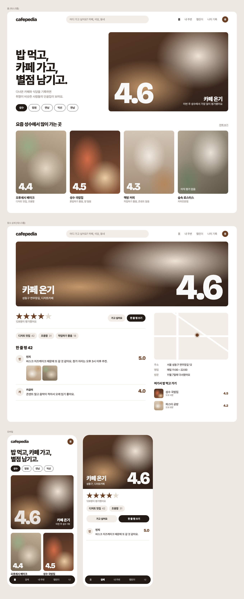

<div align="center">

# ☕ cafepedia 🍚

**밥 먹고, 카페 가고, 별점 남기고.**

다녀온 카페와 식당에 별점을 남기고,<br>
취향이 비슷한 사람들의 별점으로 다음에 갈 곳을 고르는 웹 서비스




</div>

## ✨ MVP 기능

| | 기능 | 한 줄 설명 |
| --- | --- | --- |
| **기록** | ⭐ 별점 + 한 줄 평 | 0.5 단위 별점, 방문일, 키워드 3개, 사진 3장. 같은 별을 다시 누르면 지워져요 |
| | 📅 캘린더 · 📒 나의 기록 | 다녀온 날에 사진이 붙는 달력, 별점 분포와 보관함 |
| | 💛 가고 싶어요 | 가 보고 싶은 곳 찜 |
| **찾기** | 🔍 검색 · 📍 내 주변 | 카카오 로컬 API로 이름·동네 검색, 반경 500m~3km |
| | 🏆 랭킹 | 분류·키워드·동네별, 베이지안 평균 |
| | 🕘 최근 본 장소 | 검색 화면에 표시, 이 브라우저에만 저장 |
| | 🍽️ 근처 이어가기 | 카페에선 근처 식당, 식당에선 근처 카페 |
| **신뢰** | 🧾 영수증 인증 | 영수증으로 방문 인증, 인증 리뷰와 인증 평균 따로 보기 |
| **취향** | 🔮 취향 기반 추천 | 별점 패턴이 비슷한 사람들로 **예상 별점** 계산 |
| | 📊 취향 분석 | 내 평균 vs 전체 평균, 자주 고른 키워드·종류·동네 |
| | 👥 팔로우 | 팔로우한 사람의 최근 별점을 "팔로잉 소식"으로 |
| **나누기** | 🗂️ 컬렉션 | "카공하기 좋은 카페"처럼 장소를 묶어 공개, 좋아요 |
| | 🔗 공유하기 | 카카오톡 공유, 링크 복사 |

로그인은 아이디·비밀번호 또는 카카오로 시작하기.

## 🧠 이렇게 동작해요

**취향 기반 추천 (기준선 + 이웃, KNNBaseline)**: 예상 별점 = 전체 평균 + 내 성향(후하게·짜게 주는 정도) + 장소 수준, 여기에 취향 비슷한 사람들이 기준선보다 얼마나 높게·낮게 줬는지를 더해요. 평가가 적은 장소·사람은 평균 쪽으로 당기고, 같이 평가한 곳이 적은 사람의 유사도는 깎아요. 정확도는 `manage.py eval_recommend` 로 RMSE를 재요. 평가가 5개 미만이면 내가 좋아한 종류·자주 가는 동네로 대신 추천해요. ([`recommend.py`](backend/api/recommend.py))

**랭킹 (베이지안 평균)**: `(별점 합 + 3 × 전체 평균) / (평가 수 + 3)`. 별점 하나짜리 5.0이 1등이 되지 않아요.

**장소 사진**: 리뷰 사진 → 이미지 검색에서 크기·비율로 거른 원본 → 미리보기 → 커피색 타일 순. 엉뚱한 사진은 "사진이 이상해요"로 바꿔요.

## 🛠️ 기술 스택

| 영역 | 사용 |
| --- | --- |
| 백엔드 | Django 5.2, Django REST Framework, JWT |
| 프론트엔드 | React, Vite, React Router |
| DB | 개발 SQLite, 배포 PostgreSQL |
| 외부 API | 카카오 로컬·지도·로그인·공유, 다음 이미지 검색, CLOVA OCR |

장소는 **카카오 장소 ID**로 저장해 중복 등록을 막아요. 테이블: User, Place, Review, ReviewPhoto, Wishlist, Follow, Collection, CollectionItem, CollectionLike.

## 🎨 디자인

사진이 주인공이고, 사진 위의 큰 별점 숫자가 브랜드예요. Pretendard + Bricolage Grotesque, 흰 바탕에 에스프레소 `#221A15`·브라운 `#6B3F24`·라떼 `#F2EDE7`.

시안: [전체](docs/mockup-v2.html) · [영수증 인증](docs/mockup-receipt.html) · [추천·취향](docs/mockup-taste.html) · [모바일 탭 바](docs/mockup-tabbar.html)

## 🚀 로컬에서 실행하기

Python 3.12+, Node.js 20+

```bash
# 백엔드 (localhost:8000)
cd backend
python3 -m venv .venv && .venv/bin/pip install -r requirements.txt
cp .env.example .env   # DJANGO_SECRET_KEY, KAKAO_REST_API_KEY 등
.venv/bin/python manage.py migrate && .venv/bin/python manage.py runserver
```

```bash
# 프론트엔드 (localhost:5173)
cd frontend && npm install && npm run dev
```

```bash
# 테스트
cd backend && .venv/bin/python manage.py test
```

## 🗺️ 다음에 할 일

- [ ] **배포**: 백엔드 Render, 프론트 Vercel, DB PostgreSQL
- [ ] 홈 바로가기, 나의 기록에 이번 달 캘린더 미리보기
- [ ] README 스크린샷을 실제 화면으로 교체

상세: [docs/ROADMAP.md](docs/ROADMAP.md)
