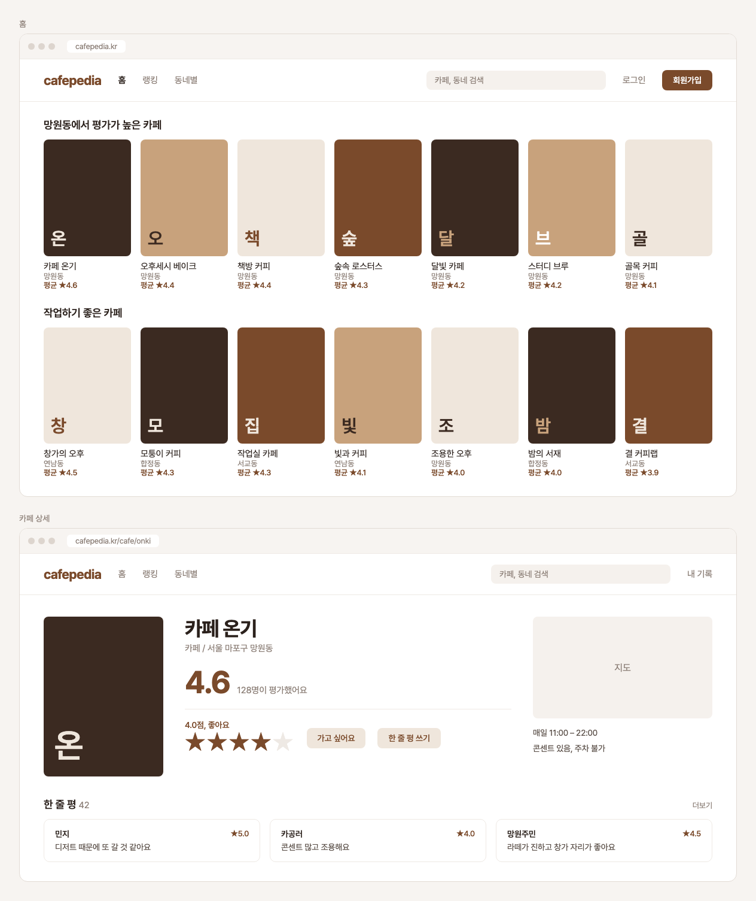

# cafe-pedia ☕

카페피디아 — 다녀온 카페에 별점과 한 줄 평을 남기고, 다른 사람의 평가로 갈 카페를 고르는 웹 서비스.

## 프로젝트 개요

밥 먹고 카페 가는 걸 좋아해서 시작한 프로젝트. 영화 평가 서비스처럼 **카페를 별점으로 기록하고 공유**한다.

- 목적: 취업 포트폴리오 + 내가 직접 쓰는 서비스
- 기간: 약 4주 (MVP 3주 + 추가 기능·배포 1주)
- 결과물: 배포된 웹 서비스 + 정리된 README

## 개발자 정보 (Claude가 참고할 것)

- 파이썬 가능, 웹 개발 경험 있음
- 새 개념(인증, DB 설계, 외부 API 등)이 나오면 짧게 이유를 설명하면서 진행
- 답변과 주석은 한국어로

## 핵심 기능 (MVP)

1. **회원가입 / 로그인**
2. **카페 검색** — 카페 이름이나 지역으로 검색 (카카오 로컬 API 활용)
3. **카페 상세 페이지** — 주소, 지도, 평균 별점, 다른 사람의 평가 목록
4. **별점 + 한 줄 평 남기기** — 0.5 단위 별점(0.5~5.0), 수정·삭제 가능
5. **내 기록 페이지** — 내가 평가한 카페 목록, 별점 분포

## 추가 기능 (시간 남으면)

- "가고 싶어요" 찜 목록
- 태그 평가 (☕ 커피 맛집 / 🍰 디저트 / 💻 작업하기 좋음 / 🔇 조용함 등)
- 태그·지역별 카페 랭킹
- 내 취향 분석 (자주 주는 별점, 좋아하는 태그)
- 다른 사용자 팔로우

## 데이터 / 외부 API

- **카카오 로컬 API** (https://developers.kakao.com) — 카페 검색 및 위치 정보. 앱 등록 후 REST API 키 발급 필요
  - 카페 정보를 직접 입력받지 않고 카카오 장소 ID를 기준으로 저장 → 같은 카페가 중복 등록되지 않음
- **카카오 지도 JavaScript API** — 상세 페이지 지도 표시
- API 키는 `.env`에 저장하고 절대 커밋하지 않기 (`.gitignore`에 `.env` 포함)

## 데이터 구조 (초안)

| 테이블 | 주요 항목 |
| --- | --- |
| User | 아이디, 닉네임, 비밀번호(해시) |
| Cafe | 카카오 장소 ID, 이름, 주소, 좌표 |
| Review | 사용자, 카페, 별점, 한 줄 평, 작성일 (사용자·카페 쌍마다 1개) |

## 일정

- **1주차**: 기술 스택 확정, 프로젝트 세팅, 회원가입·로그인, DB 모델 설계
- **2주차**: 카카오 API로 카페 검색, 카페 상세 페이지, 별점·한 줄 평 작성
- **3주차**: 내 기록 페이지, 평균 별점 계산, 화면 다듬기 (모바일 대응)
- **4주차**: 추가 기능 1~2개, 배포, README 정리 (스크린샷, 기술 선택 이유)

## 디자인 방향

> 시안 원본: [docs/mockup.html](docs/mockup.html) — 카페 이름·리뷰는 예시 데이터

- **데스크톱 웹 우선** — 웹사이트로 먼저 배포. 화면이 좁아지면 카드 수가 줄어드는 반응형 처리는 함께 한다
- **글꼴**: Pretendard (로고·평균 별점 숫자는 굵게, 자간 살짝 좁게)
- **색**: 화이트톤 + 갈색 포인트 하나

  | 이름 | 색 | 용도 |
  | --- | --- | --- |
  | 배경 | `#FFFFFF` | 페이지 배경 |
  | 에스프레소 | `#2B211C` | 본문 글자 |
  | 브라운 | `#7A4A2B` | 포인트 (로고, 별점, 주요 버튼) |
  | 크레마 | `#C8A27C` | 카페 포스터 타일 |
  | 라떼 | `#EFE6DC` | 보조 버튼 배경, 포스터 타일 |
  | 회갈색 | `#8C7F77` | 보조 글자 |
  | 구분선 | `#EEE9E4` | 테두리, 구분선 |

- **화면 구성**
  - 홈: 상단 메뉴(홈 / 랭킹 / 동네별) + 검색창, 주제별 카페 포스터 줄 (한 줄에 6~8개)
  - 카페 상세: 포스터 | 이름·평균 별점·별점 매기기·버튼 | 지도·영업 정보 3단 구성, 아래에 한 줄 평 카드
- **카페 포스터**: 사진이 없을 때는 커피색 타일 + 카페 이름 첫 글자로 표시

## 향후 계획

웹으로 먼저 배포해 홍보하고, 반응이 좋으면 앱(PWA → React Native/Flutter)으로 확장을 검토한다. 앱에서 서버를 재사용할 수 있도록 백엔드는 API 형태로 만드는 것을 고려한다.

## 미정 사항 (첫 세션에서 결정)

- 기술 스택 — 후보: **Django** (로그인·관리자 페이지·DB가 기본 내장이라 초심자에게 유리) 또는 FastAPI + 프론트엔드 분리
- DB — 개발은 SQLite, 배포 시 PostgreSQL 검토
- 배포 플랫폼 (Render, Railway, Fly.io 등)
